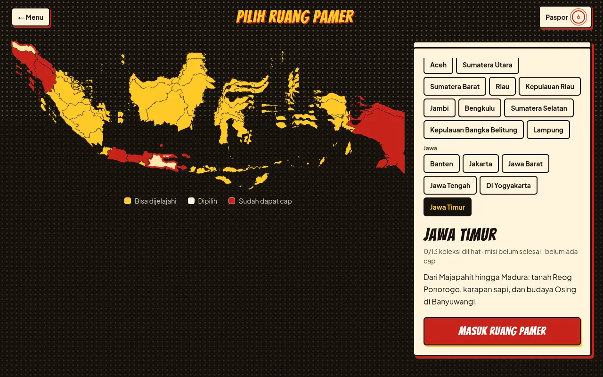
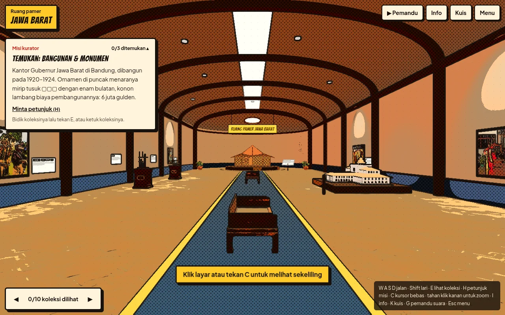
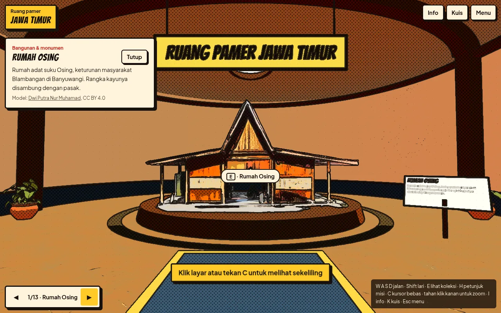
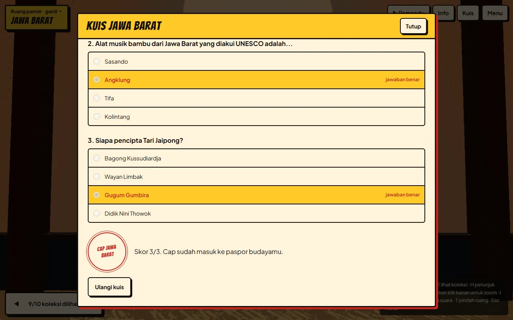
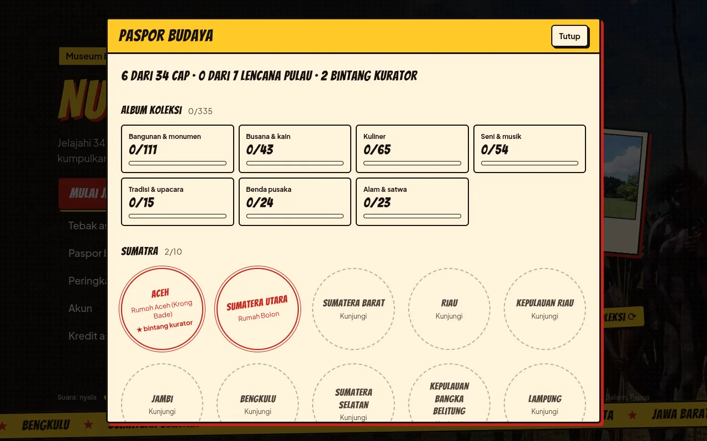
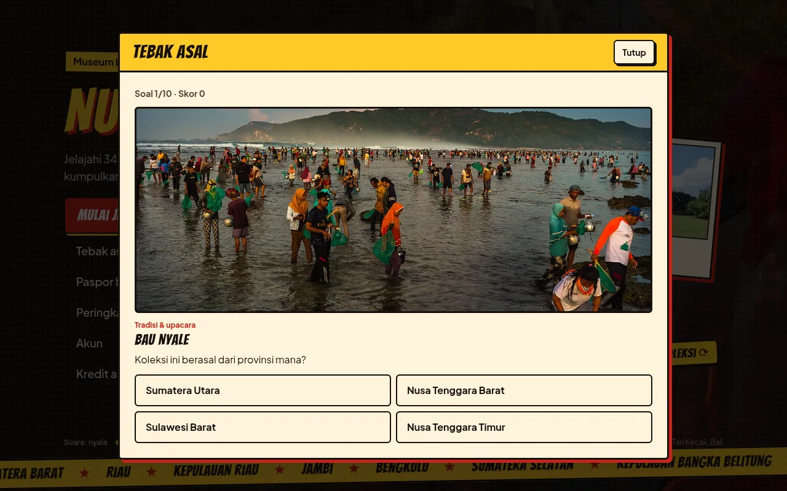
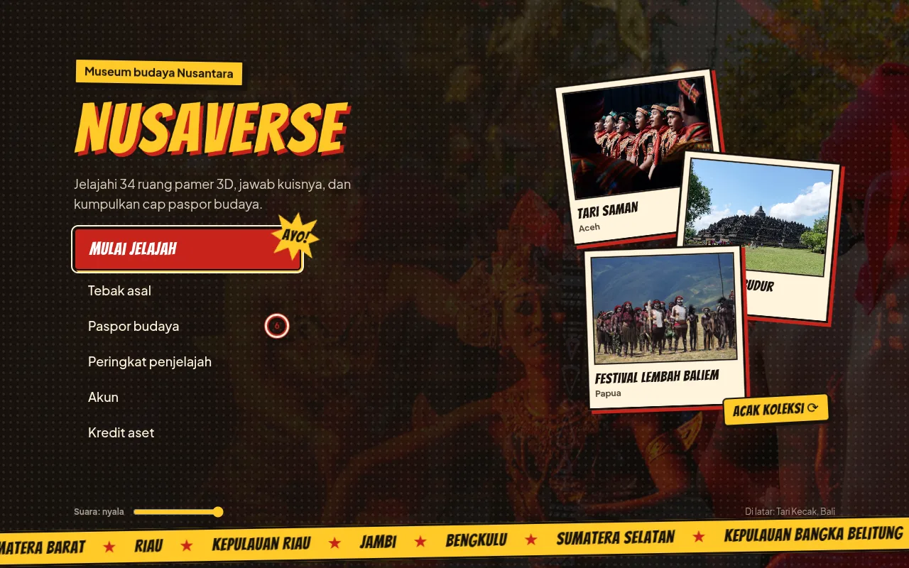

# NusaVerse

NusaVerse is a browser game about Indonesian culture. You pick a province on the map, walk through its 3D museum hall, answer a short quiz, and collect a stamp in your culture passport.

There are 34 provinces (the map predates the 2022 Papua split) and 335 exhibits, 111 of them 3D models and the rest photos. The game itself is in Indonesian.

Live at [nusaverse.naivaratech.com](https://nusaverse.naivaratech.com).

[](docs/demo.mp4)

A 40 second walkthrough, from the main menu to a new stamp in the passport. The full quality version is [docs/demo.mp4](docs/demo.mp4).

## How a visit goes

### 1. Pick a province

The map is a paper board tilted in 3D that leans a little toward your mouse. Click a province, or pick one from the list grouped by island, and it pops up out of the board like a page in a pop-up book. Double click it, press Enter, or use the big red button to go in. The camera dives into the province before the hall loads. Provinces you already stamped are red.



### 2. Walk the museum

Every province has its own hall, built with React Three Fiber. It is a barrel vaulted corridor that ends in a half dome, with the main exhibit standing in the middle of the apse. Photos hang on the walls and 3D models stand on pedestals along the way, each with a spotlight and a plaque. Carpet and trim colors change per island, and the whole scene is drawn in a comic book style with ink outlines and halftone shading.



Each hall also has a curator mission. You get a clue for one exhibit at a time (its description with the title words blanked out) and have to find it in the room. Find all three and you earn a curator star for that province.

Some exhibits make sound. The angklung in Jawa Barat plays eight notes and the talempong in Sumatera Barat plays five, from the card buttons or the number keys. Performance photos such as the Seren Taun angklung procession, Kecak, and Kutai gambus play a field recording when you open them. The Pemandu button (or G) plays a spoken tour of the province.



| Input | Action |
| --- | --- |
| Click the scene | Lock the cursor and look around |
| W A S D or arrow keys | Walk |
| Shift | Run |
| E | Open the exhibit under the crosshair |
| Hold right click | Zoom |
| C | Switch between look mode and a free cursor |
| H | Hint for the current mission |
| G | Start or stop the voice guide |
| 1 to 9 | Play the notes of the instrument whose card is open |
| I, K, P | Province info, quiz, passport |
| Esc or M | Pause menu |

On a touch screen you drag to look and hold the on-screen arrows to walk. The arrows at the bottom left jump from one exhibit to the next, though exhibits opened that way do not count for the mission. Pedestals, benches, and plants block your way like real furniture.

### 3. Take the quiz

Each province has its own quiz. Get at least two thirds right and the stamp lands in your passport.



### 4. Check your passport

The passport counts your stamps, island badges (every province on an island stamped), and curator stars. Below that is an album of the exhibits you have seen, split into seven categories. Unstamped provinces link straight back to the map.



Progress is saved in the browser, so nobody needs an account to play. It stays in sync across open tabs.

## Tebak asal

A side game from the main menu. Ten rounds, each showing an exhibit photo and four provinces to choose from. One of the wrong answers always comes from the same island, so you cannot get by on the island alone. It keeps your streak and your best score, and after each answer you can jump to that province.



## Accounts, leaderboard, and stories

Accounts use Supabase Auth with email and password. Signing in uploads the stamps on the device and pulls down the ones saved to the account. The leaderboard shows the top 20 accounts by stamp count, with ties going to whoever got their last stamp first.

Signed in players can also write a story about a province (a title of 3 to 80 characters and a body of 20 to 2000). Stories show up in that province's "Cerita warga" panel only after a curator approves them, and each account can have at most 5 waiting for review.

`/admin` is the curator room, open only to accounts with the admin role. It has totals, the moderation queue, stamps per province, and the 50 newest users with a button to grant or remove the curator role. Admins cannot change their own role. Access is enforced by row level security in the database, not just by the app.

## The main menu and the rest



The menu has an animated title over performance photos, a "Tahukah kamu?" balloon with facts from the exhibits, and three exhibit cards that open the map on their province. Arrow keys move through the menu. Background rotation and the fact cycle stop when the system asks for reduced motion.

Other details worth knowing:

- Sound effects for clicks, page turns, stamps, answers, and footsteps, with volume and mute remembered on the device.
- A fullscreen toggle in the pause menu. On Chrome and Edge, Esc opens the pause menu instead of leaving fullscreen.
- Every panel is a native `<dialog>`, so focus stays inside and Esc closes it.
- three.js is only downloaded once you reach the map, which keeps the menu fast. If WebGL fails, the hall shows an error with a retry button.
- The "Kredit aset" panel lists the author and license of every model, photo, texture, and sound.

## Tech stack

- Next.js 16 (App Router, Server Actions, `"use cache"`) and React 19
- three.js with React Three Fiber and drei
- Supabase for auth and Postgres
- Tailwind CSS 4
- vinext and Cloudflare Workers for the Cloudflare build

## Running locally

You need Node.js 22.18 or newer and pnpm.

```bash
pnpm install
cp .env.example .env.local
```

Fill in `NEXT_PUBLIC_SUPABASE_URL` and `NEXT_PUBLIC_SUPABASE_PUBLISHABLE_KEY` from Supabase (Project Settings, API). Without them the museum, quiz, and passport still work, and the account features show a notice instead.

To set up the database, run `supabase/schema.sql` once in the Supabase SQL Editor. Running it again is safe. For the first admin, sign up in the app and then run the `update` statement at the bottom of that file with your email.

```bash
pnpm dev          # Next.js dev server on http://localhost:3000
pnpm dev:vinext   # same app on Vite, http://localhost:3001
```

## Deploying to Cloudflare

The Cloudflare build uses [vinext](https://github.com/cloudflare/vinext), which runs the same `app/` directory on Vite and deploys it as one Cloudflare Worker named `nusaverse`. The config lives in `vite.config.ts` and `cloudflare.config.ts`. Cached data (the leaderboard and community stories) goes in a KV namespace that the first deploy creates.

The Supabase values are compiled into the build, so they have to be set when the build runs.

### From GitHub (Workers Builds)

In the Cloudflare dashboard, open the Worker, then Settings, Build, and set:

- Deploy command: `pnpm deploy:vinext`
- Build command: empty (the deploy command builds the app)
- Build variables: `NEXT_PUBLIC_SUPABASE_URL` and `NEXT_PUBLIC_SUPABASE_PUBLISHABLE_KEY`

The default `npx wrangler deploy` does not work with this setup. The Worker must be named `nusaverse`, or you can change `name` in `cloudflare.config.ts` to match yours.

### From your machine

With the Supabase values in `.env.local`:

```bash
pnpm exec cf auth login
pnpm deploy:vinext
```

After the first deploy, add the Worker URL to Supabase under Authentication, URL Configuration. Otherwise email confirmation links point to the wrong site.

To try the Worker build locally first:

```bash
pnpm build:vinext
pnpm start:vinext
```

`pnpm build` still produces a regular Next.js build for Vercel or any Node host.

Two things to keep in mind on Cloudflare. vinext still marks `cacheComponents` support as experimental, and `next/image` serves images at full size unless Cloudflare Images is set up.

## Voice guide and exhibit sounds

The guide narration is generated once with Gemini TTS and stored as MP3 files in `public/audio/pemandu/`, so it plays in every browser. The script comes from the same province data as the info panel. After you change that data, run `pnpm guide` again. It needs `GEMINI_API_KEY` in `.env.local` and ffmpeg, and only regenerates provinces whose text changed. `pnpm check:data` fails if a narration is missing or out of date.

Sasando, sape', kolintang, tifa, and taganing are still silent because no openly licensed recordings turned up. To add one, put the file in `public/audio/koleksi/` and add an entry to `exhibitSounds` in `data/assets.ts`.

## Scripts

| Command | What it does |
| --- | --- |
| `pnpm dev` | Next.js dev server |
| `pnpm build` / `pnpm start` | Next.js production build and server |
| `pnpm dev:vinext` | Dev server on Vite |
| `pnpm build:vinext` | Build for Cloudflare Workers |
| `pnpm start:vinext` | Run the Worker build locally |
| `pnpm deploy:vinext` | Build and deploy to Cloudflare |
| `pnpm check:data` | Check province data against the map, quiz answers, and sound files |
| `pnpm assets` | Download missing models, photos, textures, and HDRI |
| `pnpm guide` | Generate the voice guide MP3s with Gemini TTS |
| `pnpm lint` | ESLint |

`pnpm assets` skips files that already exist. Models come from Sketchfab and need `SKETCHFAB_TOKEN` in `.env.local`.

## Project layout

```
app/              pages, server actions, auth callback, /admin
components/       game screens, 3D museum, quiz, passport, forms
data/             province and exhibit data, asset list, data check
lib/              Supabase clients, passport storage, sound effects
public/           models, photos, textures, HDRI, audio
docs/             README screenshots and demo video
scripts/          asset download and voice guide scripts
supabase/         database schema and policies
proxy.ts          refreshes the Supabase session cookie
```

## Credits

3D models come from Sketchfab, photos from Wikimedia Commons, exhibit recordings from Freesound and Wikimedia Commons, textures, HDRI and furniture from Poly Haven, sound effects from Kenney, and the province map from `@svg-maps/indonesia`. The voice guide is AI generated with Gemini TTS. The "Kredit aset" panel in the game lists the author and license of each item.
